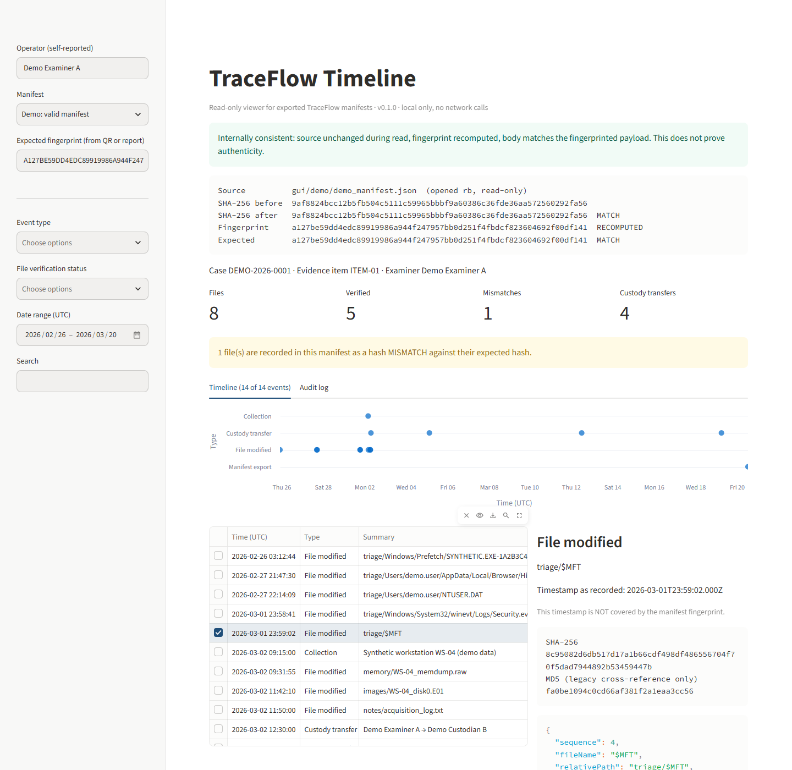
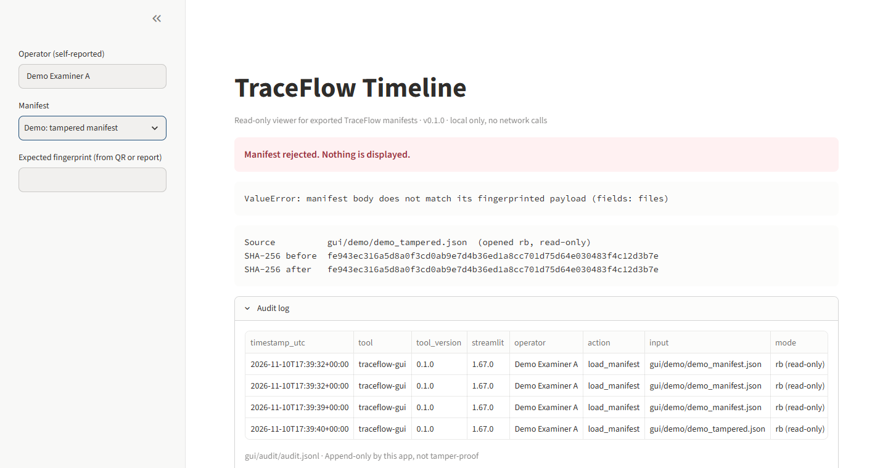
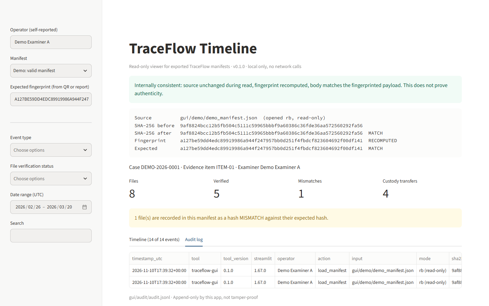

# 🔍 TraceFlow

*An Evidence Custody & Hash Manifest Engine*

*Engineered by R. Hanks*

> Part of the **[CustodyFlow](https://github.com/ryandus/custodyflow)** suite: defensible DFIR and eDiscovery workflow tools.

**[Launch Live TraceFlow Application →](https://ryandus.github.io/TraceFlow/)**

---

> **TraceFlow** is a client-side digital forensics utility designed for incident response handlers (DFIR), forensic examiners, and investigators. It computes SHA-256 hash manifests (with MD5 alongside, solely for matching legacy acquisition records) with optional verification against a reference hash, and generates tamper-evident chain-of-custody ledgers designed around ISO/IEC 27037 guidance.

## ✨ Key Features

* **🚀 SHA-256 Primary, MD5 for Legacy Matching:** Computes SHA-256 (the authoritative digest) and MD5 (only for cross-checking against legacy hash records) concurrently using stream-chunked buffers to prevent UI freezing on multi-gigabyte forensic images (`.E01`, `.001`, `.dd`, `.vmdk`, triage archives).
* **🔒 Zero Server Uploads:** All hashing and file analysis occur strictly in browser memory via streamed JavaScript hashing (js-sha256, spark-md5) and the Streams API. Evidentiary data never traverses a network.
* **📋 ISO/IEC 27037 Case Metadata:** Captures examiner credentials, write-blocker enforcement status, acquisition source types, and timestamped intake notes.
* **🔗 Append-Only Chain-of-Custody Ledger:** Track custody handoffs, evidence tape seal numbers, packaging conditions, and digital signatures to support FRE 901 authentication.
* **💾 Local State Persistence:** Stores active manifests and custody sessions in client-side IndexedDB with auto-save redundancy.

## 📑 Forensic Export Formats

* 📄 **Forensic Legal PDF** (with print-optimized layout)
* 🤖 **Cryptographic Verification JSON** (machine-readable ISO 8601 schema)
* 📊 **eDiscovery CSV** (compatible with Relativity, Nuix, or court exhibit indices)

## 🛠️ Tech Stack

* **Frontend:** TypeScript, React, Tailwind CSS
* **Cryptography:** js-sha256 (streamed SHA-256, primary), spark-md5 (streamed MD5, legacy cross-reference only)
* **Persistence:** Client-side IndexedDB
* **Build & CI/CD:** Vite, Bun, GitHub Actions, GitHub Pages

## 🖥️ Timeline Viewer (Streamlit, local only)

A read-only desktop viewer for manifests exported by TraceFlow (**Cryptographic Verification JSON**). It does not re-hash evidence files or touch the web app's code. It recomputes only the manifest fingerprint, mirroring manifestFingerprint() in src/services/qrAudit.ts, so the two must be kept in sync. It reads the exported manifest and lays its events out on a timeline: collection, file last-modified times, custody transfers, and the export itself.

Requires **Python 3.11+**. The only direct dependency is Streamlit.

```bash
pip install -r gui/requirements.txt
streamlit run gui/app.py        # run from the repo root; serves on http://localhost:8501 only
```



**What it checks on every load**

* Opens the manifest `rb` only and never writes to it. SHA-256 of the file is taken before parsing and again after, and both are shown.
* Recomputes the manifest fingerprint (SHA-256 of the canonical payload) and confirms the manifest body matches that payload.
* Optionally compares the fingerprint against one you supply from the printed QR code or report. A mismatch is a hard stop.
* Any failure (unreadable file, bad JSON, missing field, mismatch) rejects the whole manifest. Nothing is partially displayed.



**What it does not prove.** A passing check means the manifest is internally consistent, not that it is authentic: someone who edits a manifest can also recompute its fingerprint. Authenticity comes from comparing against a fingerprint held elsewhere, which is what the expected-fingerprint field is for. File last-modified times and the export time are not covered by the fingerprint, and the viewer labels them as such.

**Audit log.** Every load, pass or fail, is appended to `gui/audit/audit.jsonl` (git-ignored) with UTC timestamp, tool version, self-reported operator, input path, SHA-256 before and after, and outcome. It is append-only by this app, not tamper-proof. Paths are stored repo-relative; a manifest outside the repo is recorded by file name and SHA-256 only.



**Local only.** `.streamlit/config.toml` binds to `localhost` and disables usage statistics. Manifest text is always rendered as literal text, so markdown or image links inside a manifest are never rendered or fetched.

The demo manifests in `gui/demo/` are synthetic and regenerated deterministically by `python gui/make_demo.py`. All screenshots show that synthetic data.

## 📄 License

This project is open-source and licensed under the MIT License.
